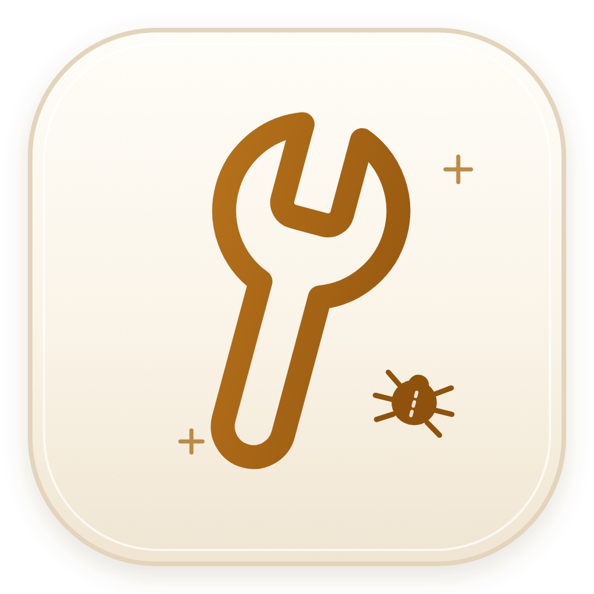
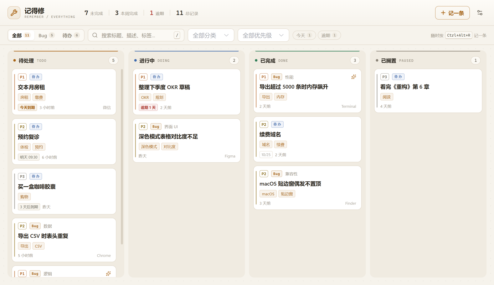
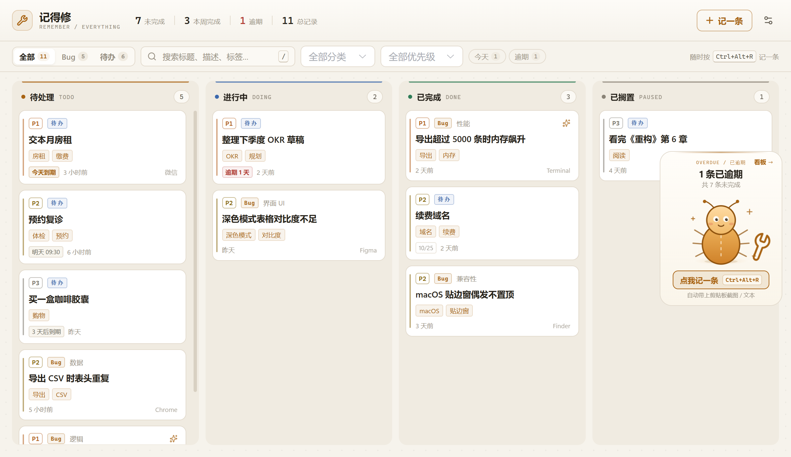

<p align="center">
  
</p>

<h1 align="center">记得修 · Remember-Fix</h1>

<p align="center">截屏即记录，AI 自动补全，看板跟进到修完。</p>

<p align="center">
  
  
  
  
  
  
</p>



## 这是什么

记得修是一款面向 Windows 与 macOS 的本地优先 Bug 捕获与管理工具。按下全局热键，它会读取剪贴板里刚截的图或复制的报错文本，打开一个轻量捕获窗；保存后 AI 自动补全标题、分类、严重度、标签、摘要和复现步骤，再用五列看板跟踪修复状态。

适合个人开发者、QA 和需要随手记录问题的小团队。

## 功能

- **一键捕获**：全局热键或托盘 / 菜单栏唤起，自动识别剪贴板截图 / 文本；保留最近剪贴板历史，支持 `Alt / Option + ←/→` 切换、文本复制、截图插入描述。
- **AI 自动补全**：保存新记录后异步分析截图和文本，生成标题、分类、严重度、标签、摘要与复现步骤；只回填空白字段，不覆盖手填内容。
- **AI 可控**：可关闭 AI、测试连接、手动重新分析、批量分析未处理记录；失败时保留上一次成功结果，不影响正常保存。
- **五列看板**：待处理 / 进行中 / 已修复 / 已验证 / 不修，原生拖拽流转，自动统计待修与本周清掉数量。
- **检索与筛选**：`/` 快速聚焦搜索，按标题、描述、标签、来源搜索，支持分类 + 严重度组合筛选。
- **详情编辑**：富文本描述（加粗、列表、表格、代码块、截图）、状态 / 分类 / 严重度 / 标签编辑、附件预览、`Ctrl / ⌘ + S` 保存。
- **修复指令**：根据 Bug 与 AI 结论生成可直接投喂 Claude Code / Cursor 的 Markdown 修复提示，包含定位建议、验收标准和回归风险。
- **Markdown 导出**：按状态导出全部记录，自动复制截图到 `assets/`，保留 AI 摘要、复现步骤和文本日志。
- **桌面体验**：热键可改、关闭收托盘 / 菜单栏、单实例唤醒、开机自启、窗口位置与原生亮色标题栏。
- **贴边宠物**：屏幕边缘常驻一枚小虫标签，悬停展开成宠物卡片，点一下直接带入剪贴板截图 / 文本；有未处理记录时标签上带数量徽标，并按 45–90 分钟随机做一次约 2 秒的短脉冲提醒（每天最多 3 次，22:00–09:00 静默，捕获窗打开时跳过），悬停卡片可一键进入只看待处理的看板。按住卡片可拖到屏幕任意一边，位置会记住，也可在设置中随时关闭。
- **本地优先**：SQLite + 本地截图目录，无账号、无遥测、无云端同步。

## 快速开始

### 环境要求

- Windows 10 / 11（需要 WebView2 Runtime），或 macOS 12+（Intel / Apple Silicon）
- Go 1.27.2+（与 `go.mod` 一致）
- Node.js 20.19+ 或 22.12+（CI 使用 24）
- Wails 3 CLI（`v3.0.0-beta.34`）
- Windows 打包 NSIS 安装器需要安装 NSIS 并加入 PATH（CI 会自动安装）；macOS 构建需要 Xcode Command Line Tools（`xcode-select --install`），剪贴板读取使用 CGO + Cocoa

### 开发运行

```bash
git clone https://github.com/lybxkl/remember-fix.git
cd remember-fix

go install github.com/wailsapp/wails/v3/cmd/wails3@v3.0.0-beta.34

cd frontend
npm install
cd ..

wails3 dev
```

### 生产构建

```bash
# 构建当前系统
wails3 build

# 可选：打包当前系统的安装包 / 应用包
wails3 package
```

- Windows 输出 `bin/remember-fix.exe`，`wails3 package` 生成 NSIS 安装包。
- macOS 输出 `bin/remember-fix`，`wails3 package` 生成 `bin/remember-fix.app`（ad-hoc 签名）；`wails3 task darwin:package:universal` 生成 Intel + Apple Silicon 通用包。
- macOS 的 `.app` 需要在 macOS 上构建；Go 剪贴板代码依赖 Cocoa 与 Xcode Command Line Tools。Darwin 构建默认带 `private_mac_apis` 标签，用于让贴边窗的 WebView 真正透明；该标签不适合 Mac App Store 上架，本项目通过 GitHub Release 分发。

### 自动构建与发布

GitHub Actions 工作流见 [.github/workflows/package.yml](.github/workflows/package.yml)。推送 `v*` tag 或手动运行工作流即可构建并发布：

```bash
# 版本号需与 build/config.yml 的 info.version 一致
git tag v0.1.0
git push origin v0.1.0
```

也可以在 Actions → **Package Desktop App** → **Run workflow** 中填写已存在的 tag。

发布产物：

- `remember-fix-windows-amd64.exe`：Windows 便携版
- `remember-fix-windows-amd64-installer.exe`：Windows NSIS 安装包
- `remember-fix-macos-universal.dmg` / `remember-fix-macos-universal.zip`：Intel + Apple Silicon 通用包

发布前只需修改 `build/config.yml` 的 `info.version` 并打对应 tag；CI 会运行 `wails3 update build-assets`，把版本同步进 NSIS、Windows 资源与 macOS Info.plist。本地打包前可手动执行 `wails3 task common:update:build-assets`。macOS 包使用 ad-hoc 签名，未做 Apple 公证。

### 测试

```bash
# 根包通过 go:embed 嵌入 frontend/dist，先构建前端再跑 Go 测试
cd frontend && npm run build && cd ..
go test ./...
```

前端构建会执行 TypeScript 类型检查、Vite 打包和 bundle 体积检查。

## 使用方式

1. 截取问题画面到剪贴板，或复制一段报错日志：
   - Windows：`Win + Shift + S`
   - macOS：`⌘ + Ctrl + Shift + 4`（区域截图并直接写入剪贴板）
2. 按默认热键，或点击托盘 / 菜单栏图标；也可以把鼠标移到屏幕边缘的小虫标签，点开贴边宠物。
   - Windows：`Ctrl + Alt + R`
   - macOS：`⌘ + Option + R`
   - 热键都可在设置中修改。
3. 在捕获窗补一句话 / 描述；标题留空时由 AI 生成。
4. 点击“记下来”或按 `Ctrl / ⌘ + Enter`。AI 在后台补全信息，卡片会实时刷新。
5. 在详情抽屉里完善记录、生成修复指令，或把卡片拖到对应状态。

### 贴边宠物

鼠标移到屏幕边缘的琥珀色小虫标签上，它会展开成一张宠物卡片；点卡片或按提示热键即可记录当前剪贴板内容，捕获窗打开后宠物自动收起。按住卡片拖动，松手会自动吸附到最近的屏幕边缘，下次启动仍在原位置。

有未处理的记录时，收起标签上会显示数量徽标，并按 45–90 分钟的随机间隔做一次约 2 秒的短脉冲；每天最多 3 次，22:00–09:00 静默，捕获窗打开时自动跳过。它不会自动展开，也不会弹系统通知。悬停卡片能看到「N 条还挂着 / 最久的一条 X 天了」，点「看板 →」会打开主窗并切到只看待处理的视图；点宠物本身仍然是记一条 Bug。设置 → 桌面贴边 可以关闭提醒（徽标保留）或整体关闭贴边宠物。



## AI 配置

在“设置 → AI 分析”中填写端点、API Key 和模型。

- 默认端点：`https://token-plan.cn-beijing.maas.aliyuncs.com/apps/anthropic`
- 默认模型：`qwen3.8-max`（支持看图）
- 协议：Anthropic Messages（`POST /v1/messages`，`x-api-key` + `anthropic-version: 2023-06-01`）
- 该端点实测可用：`qwen3.8-max` / `qwen3.7-plus`（均支持图片输入）
- 也可以填写其他兼容 Anthropic Messages 的服务端点

API Key 仅保存在本机数据库中，并只会发送到你配置的 AI 端点，不会进入源码、构建产物或本仓库。

> 当前会把 API Key 以明文形式保存在本机 SQLite 中，后续计划接入 Windows DPAPI / macOS Keychain 加密。

## 数据与隐私

所有数据默认保存在：

```text
# Windows
%APPDATA%\remember-fix\
├── remember-fix.db      # SQLite 数据库（记录、设置、API Key）
├── shots\               # 截图原图
├── exports\             # Markdown 导出
└── remember-fix.log     # 运行日志

# macOS
~/Library/Application Support/remember-fix/
├── remember-fix.db
├── shots/
├── exports/
└── remember-fix.log
```

- 没有账号体系，没有遥测，没有第三方统计。
- 只有保存新记录或手动触发时，才会把该记录的文本 / 截图发送到你配置的 AI 端点。
- 关闭 AI 后应用可完全离线使用。
- 删除数据目录即可清空全部本地数据。

## 技术栈

| 层 | 技术 |
|---|---|
| 桌面外壳 | Wails v3 beta.34（多窗口、托盘、全局热键、单实例） |
| 后端 | Go 1.27、`database/sql`、`modernc.org/sqlite`（SQLite 本身无需 CGO） |
| 剪贴板 | Windows：Win32 `GetClipboardSequenceNumber`、PNG / DIBV5 / DIB 解析；macOS：`NSPasteboard`（CGO + Cocoa） |
| AI | Anthropic Messages 兼容客户端、图片 + 文本输入、严格 JSON 提取 |
| 前端 | Vue 3、TypeScript、Vite、Element Plus、TipTap 3、lucide-vue-next、markdown-it |
| 存储 | SQLite（WAL） |
| 导出 | Markdown + 本地截图副本 |

## 项目结构

```text
remember-fix/
├── main.go                    # 应用组装：窗口、托盘、热键、单实例、资源路由
├── services.go                # Wails 绑定：Capture / Bug / Config / Edge / AppShell
├── internal/
│   ├── ai/                    # Anthropic 客户端、分析 prompt、JSON 解析
│   ├── autostart/             # Windows HKCU Run / macOS LaunchAgent 开机自启
│   ├── capture/               # 剪贴板快照、序列号去重、历史
│   ├── clipboard/             # Win32 与 NSPasteboard 两套实现（按平台构建）
│   ├── exporter/              # Markdown 导出与截图复制
│   ├── fsx/                   # 数据目录、路径校验、截图落盘
│   ├── models/                # 领域模型
│   └── store/                 # SQLite、设置、CRUD、AI 状态
├── frontend/
│   ├── index.html             # 主窗口（看板）
│   ├── capture.html           # 捕获窗
│   ├── edge.html              # 贴边宠物窗
│   └── src/
│       ├── apps/              # BoardApp / CaptureApp / EdgePetApp
│       ├── components/        # 看板、抽屉、设置、编辑器、空状态
│       ├── composables/       # 数据加载、设置、捕获
│       └── lib/               # 类型、常量、Wails 事件、Markdown
├── build/                     # 图标、Windows manifest、macOS .app 配置与打包脚本
├── docs/                      # 设计说明、截图
└── Taskfile.yml
```

详细设计见 [docs/design.md](docs/design.md)。

## 实现要点

- Windows 剪贴板图片优先读取截图工具写入的原始 `PNG`，再回退 `CF_DIBV5` / `CF_DIB`；macOS 优先读 `NSPasteboardTypePNG`，截图工具只写 TIFF 时用 AppKit 转成 PNG。
- 通过剪贴板序列号去重（Windows `GetClipboardSequenceNumber` / macOS `changeCount`），同一张截图不会重复落盘。
- AI 分析异步执行并按记录去重；失败只更新状态，不覆盖上一次成功结果。
- Markdown 导出按状态分组，并把截图复制成相对路径，导出目录可整体移动。
- 贴边宠物是一块透明、置顶、不进任务栏的窄窗口；悬停时按 DPI 读取实际窗口尺寸并重新贴住屏幕边缘，点击后复用统一的捕获入口；拖动松手后吸附最近边缘，并把贴边方向与位置写入设置。
- 平台差异集中在 `internal/clipboard`、`internal/autostart`、`internal/store/defaults_*.go` 与 `frontend/src/lib/platform.ts`；其余业务代码共用。
- 应用数据只在本地；仓库不包含运行时数据库、日志、截图、导出或可执行文件。

## 已知说明

- Windows 已在实机完整验证；macOS 的剪贴板 / 打包 / 自启代码已实现，但当前作者只在 Windows 环境开发，macOS 需在真机上完成首次构建与回归。
- Windows 安装包未做代码签名，SmartScreen 可能提示；可选择“更多信息 → 仍要运行”。
- macOS 首次打开 ad-hoc 签名（未公证）的 `.app` 时，若被 Gatekeeper 拦截，可右键“打开”，或执行 `xattr -dr com.apple.quarantine /path/to/remember-fix.app`。
- macOS 开机自启写入 `~/Library/LaunchAgents/com.rememberfix.desktop.plist`，登录后生效；建议先把 `.app` 放进 `/Applications` 再开启自启，移动应用位置后需要重新开关一次自启。
- AI 分析与修复指令生成依赖网络；使用 `qwen3.8-max` 时，修复指令生成通常需要 1–2 分钟。
- `go vet` 对 Windows 剪贴板指针助手有一个已知 `unsafe.Pointer` 误报，不影响构建和运行。

## License

[Apache-2.0](LICENSE)
